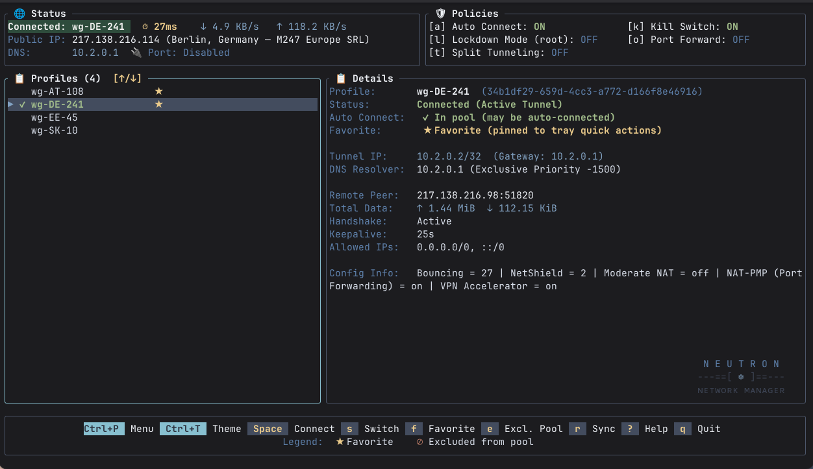

<!--suppress HtmlDeprecatedAttribute -->
<h1 align="center">
  N E U T R O N<br>
  ---==[ ⚛ ]==---<br>
  <small>ɴ ᴇ ᴛ ᴡ ᴏ ʀ ᴋ &nbsp; ᴍ ᴀ ɴ ᴀ ɢ ᴇ ʀ</small>
</h1>

<!--suppress HtmlDeprecatedAttribute -->
<p align="center">
  
</p>

A lightweight, high-performance WireGuard manager for Linux built in Rust, utilizing NetworkManager as the underlying
networking control plane. Designed to be minimal and resource-efficient, Neutron runs as a standalone ~3–5 MB binary
with zero dynamic dependencies, uses only ~10–15 MB of RAM, idles at 0% CPU, and launches in under 10 ms.

---

## Key Features

- **Connection Management**
- **Random Profile on Boot**
- **Global Split Tunneling**
- **Port Forwarding**
- **NetworkManager-Native Kill Switch**
- **Always-On Lockdown Mode (blocking all physical traffic while disconnected)**
- **NetworkManager profile sync**
- **Multi-File Profile Import**
- **Multiple Interfaces (TUI, CLI)**
- **qBittorrent automatic port synchronization**
- **qBittorrent automatic wg profile binding**

---

## Quick Start

### 1. One-Line Install

Install via [Homebrew](https://brew.sh/) (including tap trust so background auto-updates work seamlessly):

```bash
brew tap pandabytez/tap && brew trust pandabytez/tap && brew install neutron
```

Or install the existing stable source tag with Cargo:

```bash
cargo install --locked --git https://github.com/PandaBytez/neutron.git --tag v0.2.0
```

For fixes newer than that tag, use `--rev <reviewed-commit-sha>` instead of
`--tag v0.2.0`. This documentation describes current source behavior, not a
promise that the stable tag or published packages contain every fix. Homebrew,
Cargo, and [static release binaries](https://github.com/PandaBytez/neutron/releases)
are the supported installation channels.

The NetworkManager daemon and `nmcli` must both be **1.52+** with
`ipv4.routed-dns` / `ipv6.routed-dns` support, and iproute2's `ip` is required.
Protected profiles select `routed-dns=no` and merge explicit NM-managed resolver
`/32` / `/128` routes in main table 254, including split-excluded resolvers,
without replacing defaults. Unprotected profiles select `yes`; that property
alone is not a protection guarantee. After protected activation/reapply, kernel
UDP/TCP DNS egress must select the tunnel or Neutron attempts disconnection and
reports an error. Static linking does not remove
the need for system tools and services; lockdown also needs firewalld and polkit.

### 2. Import Profiles

Neutron automatically pre-creates `~/.config/neutron/profiles/` with secure user-only permissions (`0700`). Simply place
your WireGuard configuration files (`*.conf`) into the drop directory in your file manager app or use command:

```bash
mv *.conf ~/.config/neutron/profiles/
```

> **Note:** If you already have WireGuard profiles loaded in NetworkManager, you can skip this step — Neutron detects
> and manages all existing NetworkManager profiles automatically.

### 3. Launch TUI & Useful Commands

#### Interactive Terminal UI (Recommended)

Launch the full interactive TUI:

```bash
neutron
```

Browse profiles, connect/disconnect with `Space` or `Enter`, switch profiles with `s`, configure split tunneling with
`t`, toggle the kill switch with `k`, or press `Ctrl+P` for the command palette.

#### Complete restart command

```bash
# Restart background daemon and refresh system tray state
neutron restart
```

---

## 🌐 **[Documentation](https://pandabytez.github.io/neutron/)**

See the [settings reference](docs/configuration.md) for the current `config.toml`
schema, UUID-based profile lists, theme colors, and qBittorrent binding overrides.

---

## Building from Source

```bash
# Build standard release binary
cargo build --release

# Statically-linked musl binary (zero dynamic dependencies)
rustup target add x86_64-unknown-linux-musl
cargo build --release --target x86_64-unknown-linux-musl
```

### Day-to-day commands

Most maintenance is a cargo alias, so nothing needs installing first:

| Command | What it does |
| :--- | :--- |
| `cargo reinstall` | Rebuild and install the binary, **keeping your lockdown state and settings** |
| `cargo lint` | `cargo fmt --check` plus strict clippy |
| `cargo test` | Host unit and integration tests |
| `cargo test-all` | Host tests, then the system tests in the disposable sandbox |
| `cargo docs` | Build this documentation |

`cargo reinstall` is the one to reach for while working on the app: it runs
`cargo install --locked --path . --force` and touches nothing privileged, so you do not
disable lockdown and re-authenticate on every rebuild. It verifies your settings
came through unchanged and restores them if anything touches them.

Two caveats it deliberately does not hide: the root-owned refresh helper is a
*copy* of the binary taken when lockdown was enabled, so after changing firewall
code run `neutron lockdown enable` once to refresh it; and system tests need
Podman — see [testing](docs/testing.md).

### Auto-Connect at Login

Auto-connect is **off by default**. Press **`a`** in the TUI to enable it and install the desktop autostart entry,
which connects an eligible WireGuard profile at login.

For headless servers without an XDG desktop environment, an optional user service is provided in [`systemd/`](systemd/).

### Lockdown across reboots

Lockdown is stored in firewalld's permanent configuration and takes effect when
firewalld starts, before login. Enabling/disabling it requires administrator
authentication. Enabling also installs a root-owned refresh helper and a dedicated
polkit action. **Every helper refresh requires fresh `auth_admin` authorization**;
there is no password-free grant or retained `auth_admin_keep` authorization.
The helper cannot turn lockdown on or off.

After upgrading an existing installation, run `neutron lockdown enable` once and
authenticate to replace the old password-free helper grant. Current source refuses
to invoke unsafe grants, checking both action directories and legacy rules even
when a hardened action is also installed. Authenticated disable revokes unsafe
helper authorization; enable migrates it. All helper-backed operations, including automatic
activation, switching, login selection, and profile/DNS reconciliation, may prompt.
Headless operation or denied authentication fails closed: required pre-activation
refresh failure stops activation and existing firewall protection stays in place.
Enabling lockdown also enables firewalld at boot on systemd systems. Polkit 126+
uses `/usr/local/share/polkit-1/actions`, supporting immutable `/usr`; older
versions require a writable `/usr/share/polkit-1/actions`.

Without lockdown, the kill switch refuses profiles with an unsupported IPv4 or
IPv6 family. Unsplit protection requires peer AllowedIPs `0.0.0.0/0` **and**
`::/0`, plus explicit tunnel DNS servers covered by AllowedIPs. It does not
silently make an IPv4-only profile IPv6-safe. Explicit split-tunnel bypasses are
intentional; lockdown can block traffic that the tunnel cannot carry.

### Resetting to factory defaults

`neutron reset` returns the app to a first-run state: it withdraws every policy
Neutron applied (the lockdown ruleset and its root-owned helper, the kill switch,
the split-tunnel routes), clears all settings — eligibility pool, favorites,
notes, qBittorrent credentials — and removes the autostart entry. It asks you to
type `reset` to confirm, or takes `--yes` unattended; a non-interactive stdin
refuses rather than wiping anything.

Your WireGuard profiles are only edited to withdraw what Neutron wrote, and the
profile drop directory is reported and left alone. Lockdown teardown runs first
and aborts the reset on failure, so a half-finished reset can never leave a
machine firewalled with no configuration explaining why.

### Uninstalling

Run `neutron uninstall` as your normal user. It stops the tray daemon, then — in
a single privileged batch, so at most one password prompt — lifts lockdown if any
of its state is actually present, removes the authenticated refresh helper (the
root-owned helper and its polkit action), and removes the autostart entry. It then
hands the binary to whichever package manager installed it: `brew uninstall
neutron` for a Homebrew install, `cargo uninstall neutron` for a `cargo install`.
An install that never enabled lockdown prompts for nothing at all.

Those root-owned files live outside the package's own file list, and no packaging
hook can remove them: Homebrew's `post_uninstall` runs *after* the files are gone,
with no way to authenticate. So the teardown has to happen while the binary still
exists — which is why it is a subcommand rather than a package script. The helper
and all known actions/legacy rules are removed here. `neutron lockdown disable`
retains only hardened authorization and revokes unsafe grants; leaving a hardened
helper installed does not waive authentication for enabling or refreshing.

`~/.config/neutron` is **kept** (eligibility pool, favorites, settings) so a
reinstall finds it intact; add `--purge` to delete it too, which is also how the
stored qBittorrent password goes away. A drop directory configured *outside* it
is always left alone, since it holds your own files.

An install Neutron does not recognize, including a manually installed static
binary, is refused with an explanation and **nothing is changed**, rather than
guessing a package manager. For a static install, run `neutron reset` before
manually removing the binary. If the binary is already gone and rules remain, see
[the manual recovery steps](docs/security.md#uninstalling-revokes-everything-it-installed).

---
