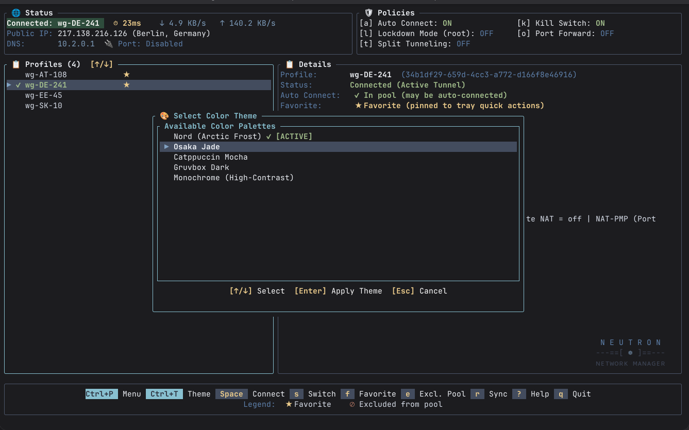

# User Configuration & Theming (`config.toml`)

Neutron uses a human-readable, self-documenting **TOML** configuration file located at `~/.config/neutron/config.toml`.

Imported profile comments are stored separately in `profile-info.json` beside the
settings file, keyed by NetworkManager profile UUID. They still appear in profile
details, but no longer clutter `config.toml`. Existing inline `profile_custom_info`
entries migrate on the next successful settings save. The notes file uses atomic
writes and owner-only permissions; deleting a profile removes its notes.

---

## Configuration File Schema

This illustrative sample uses the current serialized `AppConfig` schema, not
necessarily default values. Profile lists contain NetworkManager UUIDs, not
profile names. Replace the example UUIDs and `.invalid` documentation domains
before use; the sample is suitable for a parse-only check, not live DNS or routing.
Optional values are omitted when unset.

```toml
# ==============================================================================
# Neutron Configuration (~/.config/neutron/config.toml)
# ==============================================================================

# Root settings must precede all [tables].
# NetworkManager policy routing (drops traffic if tunnel fails; exclusive DNS priority)
kill_switch_enabled = false

# Always-on Netfilter firewall via firewalld (blocks non-tunnel traffic even when disconnected)
lockdown_enabled = false

# Every profile is eligible for startup-random selection unless its UUID is listed.
excluded_profile_ids = ["11111111-1111-4111-8111-111111111111"]
# Favorites pinned to tray quick actions, also keyed by UUID.
favorite_profile_ids = ["22222222-2222-4222-8222-222222222222"]
# Optional last random selection; maintained by the app.
last_random_profile_id = "22222222-2222-4222-8222-222222222222"

[general]
# Drop directory for WireGuard .conf files; scanned during profile sync.
profiles_dir = "~/.config/neutron/profiles"

# Automatically import new/updated .conf files from profiles_dir on launch.
auto_sync_profiles = true

# Opt in to connecting a random eligible profile at login.
autoconnect_at_login = false

# Verify fresh tunnels with an endpoint and persistent keepalive.
# Idle on-demand tunnels are exempt.
verify_tunnel_on_connect = true

# ==============================================================================
# Global Split Tunneling
# ==============================================================================
[global_split_tunnel]
# Routing mode: "disabled", "include", or "exclude".
# Include routes only listed destinations for each nonempty address family;
# an empty family retains its full-tunnel default (including an empty list).
mode = "include"

# Custom IP subnets (CIDRs) or single host IPs
cidrs = [
    "10.0.0.0/8",
    "192.168.10.0/24",
    "172.16.0.0/12",
]

# Domain names resolved dynamically at connection time
domains = [
    "internal.example.invalid",
    "homelab.example.invalid",
]

# ==============================================================================
# Terminal User Interface (TUI) & Theming
# ==============================================================================
[theme]
# Built-in theme preset: "nord" (default), "osaka-jade", "catppuccin", "gruvbox", "monochrome"
preset = "nord"

# Optional custom color overrides (accepts hex #rrggbb or standard color names)
active_border = "#88c0d0"
status_connected = "#a3be8c"
status_disconnected = "#bf616a"
transfer_rx = "#81a1c1"
transfer_tx = "#ebcb8b"

# ==============================================================================
# Port Forwarding (NAT-PMP)
# ==============================================================================
[port_forwarding]
# Policy mode: "disabled", "forward" (lease an incoming port from the tunnel
# gateway and keep renewing it), or "forward-and-sync" (also push the leased
# port to qBittorrent automatically). Switchable live from the TUI with `o`.
# Off by default: the lease is renewed on a timer against the provider, so it
# is only requested when enabled.
mode = "disabled"

# ==============================================================================
# qBittorrent Dynamic Port Forwarding Sync
# ==============================================================================
[qbittorrent]
# Syncing is decided by [port_forwarding] mode = "forward-and-sync": the
# daemon pushes NAT-PMP leased ports to qBittorrent WebUI on connect/renew.

# WebUI HTTP/HTTPS endpoint URL
url = "http://127.0.0.1:8080"

# Optional authentication (leave empty if localhost auth bypass is enabled in qBittorrent)
# username = "admin"
# password = "your-webui-password"

# Interface binding. Omitted, it is decided from the URL: a local WebUI is bound
# to the tunnel's interface along with the port, because a forwarded port only
# arrives there. Set it only for what a URL cannot answer -- a qBittorrent on this
# machine reached at a container bridge address (true), or a WebUI on another host
# that must keep its own interface (false).
# bind_interface = true
# This sample explicitly disables binding, even for the local URL above.
# Omit this line to restore URL-derived binding.
bind_interface = false

# Current generated value; maintained internally by the app. Do not hand-edit.
# Distinguishes current explicit overrides (including false) from legacy defaults.
binding_overrides_migrated = true
```

There is no saved `default_ui` or `[tui]` section: `neutron` starts the TUI,
and theme colors are flat fields in `[theme]`. Security flags and profile UUID
lists are root fields, not `[security]` or `[startup_pool]` tables.

Neutron maintains `binding_overrides_migrated` on load/save. A missing or false
marker identifies legacy settings where `bind_interface = false` was the old
default; that value migrates to URL-derived binding. With the current marker
`true`, an explicit `bind_interface = false` remains an override. Prefer
`neutron qbit config --bind false` to editing migration metadata yourself.

---

## Theming Engine

Neutron features a built-in terminal theme engine with 5 carefully calibrated color palettes that can be toggled live via `Ctrl+T`:



| Theme | Description | Accent Colors | Best For |
| :--- | :--- | :--- | :--- |
| **`nord` (Default)** | Arctic, north-bluish clean palette | Frost Cyan, Polar Night Gray | Minimalist dark setups |
| **`osaka-jade`** | Osaka Jade / Bamboo palette | Jade Cyan, Bamboo Green, Gold | Dark forest green aesthetic |
| **`catppuccin`** | Soothing pastel palette (Mocha) | Mauve, Sapphire, Peach | Modern terminal setups |
| **`gruvbox`** | Retro groove warm earthy palette | Warm Amber, Forest Green | Tiling window managers & vim users |
| **`monochrome`** | High-compatibility black & white | High-contrast ASCII/ANSI | Minimal TTYs, serial consoles, 16-color terms |

---

## Managed Profile Drop Directory (`profiles/`)

Neutron manages a dedicated profile drop directory at `~/.config/neutron/profiles/` (with strict `0700` user-only permissions).

### Workflow:
1. **Drop / Copy Profiles**: Users can simply copy `.conf` files into the directory:
   ```bash
   cp ~/Downloads/wireguard_configs/*.conf ~/.config/neutron/profiles/
   ```
2. **Auto-Sync on Launch**: Whenever the TUI or CLI runs, Neutron scans the folder, compares content checksums against NetworkManager, and batch-imports new profiles in milliseconds.
3. **Manual Sync Command**: You can trigger an instant sync via CLI or within the TUI:
   ```bash
   neutron sync
   ```
4. **Git/Dotfiles Automation**: The entire `~/.config/neutron/` folder can be tracked in a private Git repository for instant syncing across multiple machines.
